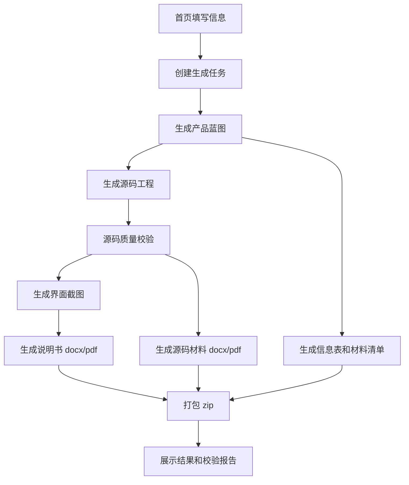

# 软著材料一键生成桌面工具 PRD 与技术方案

## 1. 产品定位

本工具面向软著材料制作场景，提供一个桌面端的一键生成系统。用户在首页输入软件名称、版本号，选择编程语言、产品类型和底层模型后，系统自动生成一个结构完整的软件源码工程，并基于该工程输出软著申请材料包。

产品核心不是简单拼接源码页，而是先生成与软件名称、产品类型、说明书内容一致的真实软件工程，再从工程中提取源码鉴别材料，降低说明书、源码、信息表之间不一致导致补正的风险。

## 2. 参考依据与样例观察

### 2.1 官方材料规则

根据《计算机软件著作权登记办法》，申请软件著作权登记通常需要提交软件著作权登记申请表、软件鉴别材料和相关证明文件；程序和文档鉴别材料一般由源程序和任一种文档的前、后各连续 30 页组成，不足 60 页的应全部提交。除特定情况外，源程序每页不少于 50 行，文档每页不少于 30 行。

产品应内置这些格式校验规则，但不能承诺“包过”。最终审核结果仍取决于申请主体、材料一致性、官方补正意见和具体登记要求。

### 2.2 用户提供样例包结构

样例压缩包包含以下类型文件：

- `软件名称.doc`
- `软件名称.pdf`
- `软件名称_代码-(Java+xml).doc`
- `软件名称_代码-(Java+xml).pdf`
- `软件名称.txt`

其中 `.txt` 信息表包含：

- 软件全称
- 版本号
- 软件分类
- 开发硬件环境
- 运行硬件环境
- 开发操作系统
- 开发工具
- 运行平台/操作系统
- 运行支撑环境/支持软件
- 编程语言
- 源程序量
- 开发目的
- 面向领域/行业
- 软件主要功能
- 软件技术特点

V1 交付格式应尽量复刻这个结构，同时统一使用 `.docx` 作为生成源文件，再通过 LibreOffice 转换为 `.pdf`。

## 3. V1 目标

1. 桌面首页直接生成，避免多步骤向导。
2. 支持客户输入软件名称并选择版本、编程语言、产品类型。
3. 支持接入 OpenAI、DeepSeek、自定义 OpenAI-compatible API。
4. 自动生成真实源码工程，并保存完整工程目录。
5. 自动生成图文并茂的软件说明书。
6. 自动生成源码鉴别材料 Word/PDF。
7. 自动生成软著申请信息表 `.txt`。
8. 自动生成材料清单。
9. 自动打包为 zip。
10. 支持重新生成，并通过随机种子、模块组合和命名风格产生差异化结果。

## 4. V1 不做的内容

1. 不承诺 100% 通过软著审核。
2. 不自动代替用户在线提交中国版权保护中心申请表。
3. 不自动生成申请主体身份证明、营业执照、合作开发协议等权属证明。
4. 不将产品宣传为“规避审核”“反查重”“包过”。
5. 不在 V1 做多人账号、云端任务队列和 Web SaaS。

## 5. 首页设计

首页就是完整工作台，所有必要选项集中在一个页面。

### 5.1 顶部区域

- 软件全称：必填，如 `景区票务与门禁智能管理系统`
- 版本号：默认 `V1.0`
- 软件简称：可选，默认根据软件全称自动生成
- 输出目录：默认 `output/{软件名称}-{时间戳}`

### 5.2 编程语言选择

采用按钮组，参考用户截图：

- Assembly language
- C
- C#
- C++
- Delphi/Object Pascal
- Go
- HTML
- Java
- JavaScript
- MATLAB
- Objective-C
- PHP
- PL/SQL
- Perl
- Python
- R
- Ruby
- SQL
- Swift
- Visual Basic
- Visual Basic .Net

V1 优先支持：

- Java
- JavaScript
- Python
- PHP
- C#
- C++
- HTML

其他语言先保留入口，提示“实验支持”或“后续支持”。

### 5.3 产品类型/软件技术特点选择

采用按钮组，参考用户截图：

- APP
- 游戏软件
- 教育软件
- 金融软件
- 医疗软件
- 地理信息软件
- 云计算软件
- 信息安全软件
- 大数据软件
- 人工智能软件
- VR 软件
- 5G 软件
- 小程序
- 物联网软件
- 智慧城市软件

下方提供 100 字以内补充输入框，用于填写特殊行业或业务场景，例如“景区票务、闸机核验、团队订单、年卡管理”。

### 5.4 模型配置

- 模型供应商：OpenAI / DeepSeek / 自定义 API
- API Base URL
- API Key
- 模型名称
- 随机度：保守 / 标准 / 高差异
- 最大重试次数
- 测试连接按钮

API Key 默认仅保存在本机配置文件，不上传云端。

### 5.5 生成控制

主按钮：

- `生成材料包`

辅助按钮：

- `重新生成`
- `只重新生成说明书`
- `只重新生成源码工程`
- `打开输出目录`
- `查看生成日志`

生成过程展示：

- 当前阶段
- 进度条
- 已生成文件
- 校验结果
- 错误提示和重试入口

## 6. 生成文件结构

输出 zip 建议结构：

```text
景区票务与门禁智能管理系统--材料包/
  景区票务与门禁智能管理系统.docx
  景区票务与门禁智能管理系统.pdf
  景区票务与门禁智能管理系统_代码-(Java+xml).docx
  景区票务与门禁智能管理系统_代码-(Java+xml).pdf
  景区票务与门禁智能管理系统.txt
  软著申请材料清单.docx
  generated_source/
    README.md
    ...
  generation_report.json
```

`generated_source/` 默认保留在 zip 内，便于证明源码材料来自完整工程。若客户不希望提交完整工程，可在软件设置中关闭 zip 内附完整工程，但本地仍保留生成记录。

## 7. 核心生成流程

### 7.1 输入归一化

系统读取首页输入后，生成标准任务对象：

```json
{
  "software_name": "景区票务与门禁智能管理系统",
  "version": "V1.0",
  "language": "Java",
  "product_type": "智慧城市软件",
  "feature_hint": "景区票务、闸机核验、团队订单、年卡管理",
  "model_provider": "deepseek",
  "randomness": "standard",
  "seed": "20260605-143000-8472"
}
```

### 7.2 产品蓝图生成

先让模型生成产品蓝图，而不是直接生成文档：

- 软件定位
- 用户角色
- 核心功能模块
- 数据实体
- 业务流程
- 技术架构
- 运行环境
- 页面/界面清单
- 源码工程结构
- 说明书章节结构

蓝图生成后进入校验：

- 功能是否与软件名称匹配
- 产品类型是否被体现
- 模块数量是否足够支撑源码行数
- 是否出现明显空泛内容
- 是否包含敏感或不合理承诺

### 7.3 真实源码工程生成

根据语言选择不同工程模板。

#### Java

推荐结构：

- Spring Boot 风格后端
- Controller
- Service
- Repository
- Entity/DTO
- Config
- Utils
- 初始化数据
- README

若选择 `Java+xml`，可补充：

- MyBatis Mapper XML
- Spring 配置 XML
- 页面/菜单 XML 配置

#### JavaScript

推荐结构：

- Node.js/Express 后端
- 前端管理页面
- 路由
- Service
- Mock 数据
- 权限中间件
- 数据模型

#### Python

推荐结构：

- FastAPI 或 Flask 风格
- routers
- services
- schemas
- models
- storage
- utils
- tests 或 demo scripts

#### PHP

推荐结构：

- Controller
- Service
- Model
- View template
- Route
- Config
- SQL 初始化脚本

#### C# / C++ / HTML

V1 可先生成较轻量的可读工程，后续逐步增加编译校验。

### 7.4 差异化生成

系统通过以下机制避免同类材料每次完全相同：

- 随机种子
- 模块组合权重
- 目录结构变体
- 类名/函数名命名风格
- 注释密度
- 配置文件风格
- UI 页面文案变体
- 数据字段组合
- 说明书章节小标题变体

本功能在产品中命名为：

- 原创化生成
- 差异化工程生成
- 内容唯一性校验

避免使用：

- 规避审核
- 反查重
- 包过
- 伪造源码

### 7.5 源码质量校验

源码生成完成后自动检查：

- 是否存在完整目录结构
- 是否存在关键模块文件
- 是否存在空文件
- 是否存在大段重复内容
- 是否仍有占位符，如 `TODO`、`your code here`、`示例内容`
- 源程序总行数是否达到目标
- 类名、模块名是否与软件业务相关
- 说明书模块是否能映射到源码文件
- 最后一页是否尽量落在完整文件或完整模块结尾

可选增强：

- Java 执行 `mvn test` 或 `gradle test`
- JavaScript 执行 `npm test` 或 `node --check`
- Python 执行 `python -m py_compile`
- PHP 执行 `php -l`

### 7.6 自动生成界面图

说明书需要图文并茂。V1 可采用“HTML 页面模板 + 自动截图”方式，不强依赖图片生成模型。

流程：

1. 根据产品蓝图生成若干 HTML 页面。
2. 页面包含登录页、首页仪表盘、核心模块列表页、表单页、详情页、统计页等。
3. 使用 Playwright 或 Chromium 截图。
4. 将截图插入说明书。

优点：

- 图片内容与软件功能一致。
- 生成速度快。
- 后期 Web 化时可复用。
- 用户不满意时可以重新生成界面图。

### 7.7 说明书生成

说明书默认采用“用户手册/操作手册”风格，章节建议：

1. 软件概述
2. 运行环境
3. 登录与主界面
4. 系统首页
5. 核心功能模块
6. 业务流程操作说明
7. 数据查询与统计
8. 系统配置
9. 权限与安全
10. 常见问题

生成规则：

- 每页不少于 30 行，插图页可例外。
- 页眉包含软件名称和版本号。
- 图注清晰，不使用“截图1”这种空泛描述。
- 说明书中的功能模块必须能在源码工程中找到对应模块。

### 7.8 源码文档生成

源码文档从 `generated_source/` 中提取，不直接让模型生成 Word 代码页。

规则：

- 若总代码不足 60 页，则全部提交。
- 若超过 60 页，则提取前 30 页和后 30 页。
- 每页不少于 50 行。
- 尽量不在文件中间突兀截断。
- 页眉包含软件名称和版本号。
- 右上角显示连续页码。
- 代码字体建议使用宋体或等宽字体，字号和行距按样例调整。

### 7.9 信息表生成

生成 `.txt` 信息表，字段参考样例：

```text
【软件全称】景区票务与门禁智能管理系统
【版本号】V1.0
【软件分类】应用软件
【开发的硬件环境】CPU：Intel Core i5，内存：8GB，硬盘：500GB
【运行的硬件环境】CPU：Intel Core i3 及以上，内存：4GB 及以上，硬盘：100GB
【开发该软件的操作系统】Windows 10 64位
【软件开发环境/开发工具】IntelliJ IDEA / JDK 17 / Maven
【该软件的运行平台/操作系统】Windows Server / Linux
【软件运行支撑环境/支持软件】JDK 17 / MySQL 8.0 / Nginx
【编程语言】Java
【源程序量】18000行
【开发目的】用于景区票务销售、验票通行和门禁管理的数字化管理
【面向领域/行业】文旅景区
【软件的主要功能】...
【软件的技术特点】智慧城市软件
```

编码建议：

- 默认 UTF-8。
- 可提供 GBK 导出选项，以兼容部分老系统或客户习惯。

### 7.10 材料清单生成

材料清单包括：

- 软件著作权登记申请表，由用户在线填写后打印。
- 软件说明书。
- 源程序鉴别材料。
- 申请人身份证明或营业执照。
- 联系人身份证明。
- 权属证明材料，如合作开发协议、委托开发协议、任务书等。
- 其他补充材料，以登记系统或代理机构要求为准。

清单文档需要明确哪些文件是系统生成，哪些文件需要用户自行准备。

## 8. 技术架构

### 8.1 推荐技术栈

桌面端：

- Electron
- Vue 3 + Element Plus，或 React + Ant Design
- TypeScript

本地服务：

- Python
- FastAPI
- python-docx
- LibreOffice headless
- Playwright/Chromium
- SQLite

模型接入：

- OpenAI-compatible Chat Completions 或 Responses API 适配层
- DeepSeek API
- 自定义 Base URL

### 8.2 模块划分

```text
desktop/
  main/                 Electron 主进程
  renderer/             首页 UI
  preload/              安全桥接

backend/
  app.py                FastAPI 入口
  config/               本地配置
  llm/                  模型适配层
  blueprint/            产品蓝图生成
  sourcegen/            源码工程生成
  screenshots/          页面生成与截图
  docs/                 说明书和源码 Word 生成
  validators/           材料校验
  packager/             zip 打包
  storage/              任务历史和本地文件管理

templates/
  source/               不同语言工程模板
  manual/               说明书模板
  ui_pages/             截图页面模板

output/
  {task_id}/
```

### 8.3 服务调用流程



## 9. 模型 Provider 设计

统一接口：

```python
class LLMProvider:
    def chat(self, messages, temperature, max_tokens, response_format=None):
        ...
```

支持配置：

- provider
- base_url
- api_key
- model
- temperature
- max_tokens
- timeout
- retry_count

模型任务拆分：

- 蓝图生成：低随机，强调一致性。
- 源码生成：中随机，强调完整度。
- 文档生成：中随机，强调可读性。
- 重新生成：高随机，强调差异化。

## 10. 本地数据与记录

建议保存：

- 输入参数
- 随机种子
- 模型名称
- 生成时间
- 生成蓝图
- 源码工程路径
- 输出 zip 路径
- 校验结果
- 错误日志

用途：

- 支持重新生成。
- 支持问题追溯。
- 支持同名软件差异化。
- 支持客户补正时快速调整。

## 11. 校验报告

生成完成后输出 `generation_report.json`，同时在桌面端展示摘要。

检查项：

- 软件名称一致性
- 版本号一致性
- 编程语言一致性
- 产品类型一致性
- 源码行数
- 源码页数
- 说明书页数
- 每页代码行数
- 每页文档行数
- 重复片段比例
- 占位符检查
- 说明书模块与源码模块映射
- Word/PDF 是否生成成功
- zip 是否生成成功

## 12. 里程碑

### M1：本地生成闭环

目标：命令行可生成完整材料包。

- 完成任务对象定义
- 完成模型配置
- 完成 Java/Python 任一语言源码生成
- 完成说明书 docx
- 完成源码 docx
- 完成 zip 打包

### M2：桌面首页

目标：Electron 首页可操作。

- 完成首页 UI
- 完成模型配置保存
- 完成生成按钮
- 完成进度展示
- 完成输出目录打开

### M3：材料规范校验

目标：生成结果能自动检查格式。

- 源码页数/行数校验
- 文档页数/行数校验
- 软件名版本号一致性校验
- 占位符和重复率检查
- 生成校验报告

### M4：多语言与多产品类型

目标：支持主流选项。

- Java
- JavaScript
- Python
- PHP
- C#
- C++
- HTML
- 15 类产品类型模板

### M5：PDF 与安装包

目标：客户可交付。

- LibreOffice PDF 转换
- Windows 安装包
- 模型连接测试
- 错误恢复
- 使用说明

## 13. 验收标准

V1 可验收条件：

1. 输入软件名称后，可以一键生成 zip。
2. zip 内包含说明书 Word/PDF、源码 Word/PDF、信息表、材料清单和源码工程。
3. 说明书内容与源码模块一致。
4. 源码文档来自真实工程文件。
5. 源码材料满足前后 30 页、不足 60 页全部提交的规则。
6. 源码每页不少于 50 行。
7. 文档每页不少于 30 行，插图页可例外。
8. 软件名称和版本号在文件名、页眉、信息表中保持一致。
9. 同样输入点击重新生成，结果存在明显差异。
10. 本地保存生成记录和校验报告。

## 14. 风险与处理

### 14.1 审核通过风险

不能承诺“包过”。处理方式：

- 做材料规范校验。
- 保持说明书、源码、信息表一致。
- 保留完整工程和生成记录。
- 输出补正友好的可编辑 Word。

### 14.2 AI 生成内容质量不稳定

处理方式：

- 拆成蓝图、源码、文档多个阶段。
- 每阶段做结构化输出和校验。
- 失败自动重试。
- 支持单独重新生成某一部分。

### 14.3 源码重复度过高

处理方式：

- 本地历史库计算相似度。
- 模块组合和命名风格随机化。
- 禁止大段模板重复。
- 生成后做重复片段报告。

### 14.4 PDF 转换环境问题

处理方式：

- 内置或检测 LibreOffice。
- 首次启动检查依赖。
- 转换失败时保留 docx，并提示安装/修复。

### 14.5 法律与权属风险

处理方式：

- 产品说明中明确“生成材料需由申请人确认真实性和权属”。
- 不宣称替代法律意见。
- 不自动生成申请主体证明。
- 避免使用第三方商标、真实品牌、受保护代码片段。

## 15. 后续 Web 化方向

桌面版跑通后，后续 Web SaaS 可以复用：

- 后端生成服务
- 模型 Provider
- 文档生成模块
- 源码工程生成模块
- 校验模块

需要新增：

- 用户账号
- 订单/套餐
- 云端任务队列
- 文件隔离与加密存储
- 模型用量统计
- 管理后台
- 在线预览和下载

## 16. 下一步开发建议

建议先做 M1，不急着做复杂桌面 UI。

第一阶段以一个本地命令跑通：

```text
输入：软件名称、版本、语言、产品类型、模型配置
输出：样例格式 zip 材料包
```

跑通后再把它接到 Electron 首页，这样可以先验证生成质量和材料格式，减少前端反复改动。
